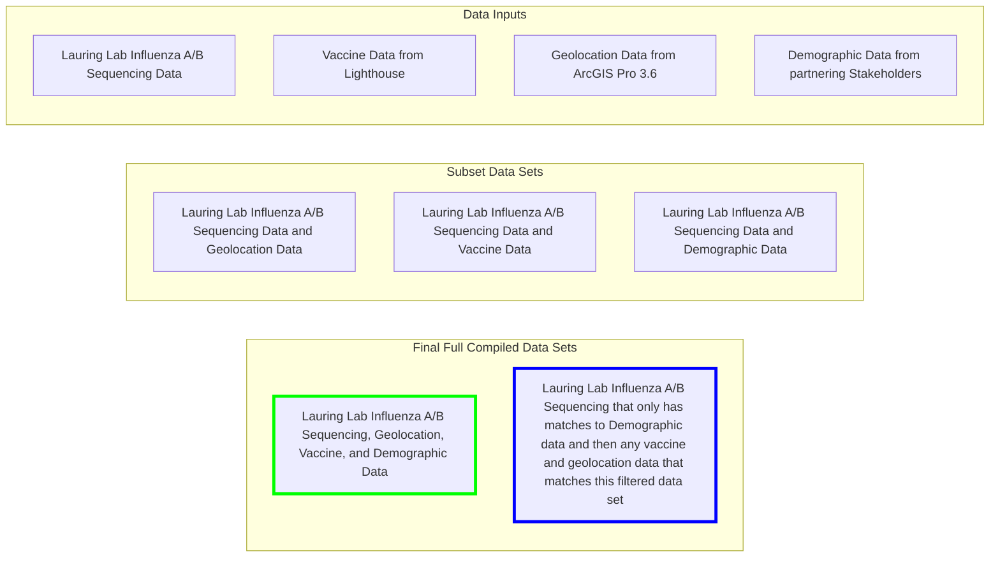

# De-identified-Influenza-Large-Dataset
Influenza A and B surveillance and research data set with sample collection dates starting in 2021 with genomic sequencing information as well as corresponding demographic, geolocation, and vaccine data when available.

